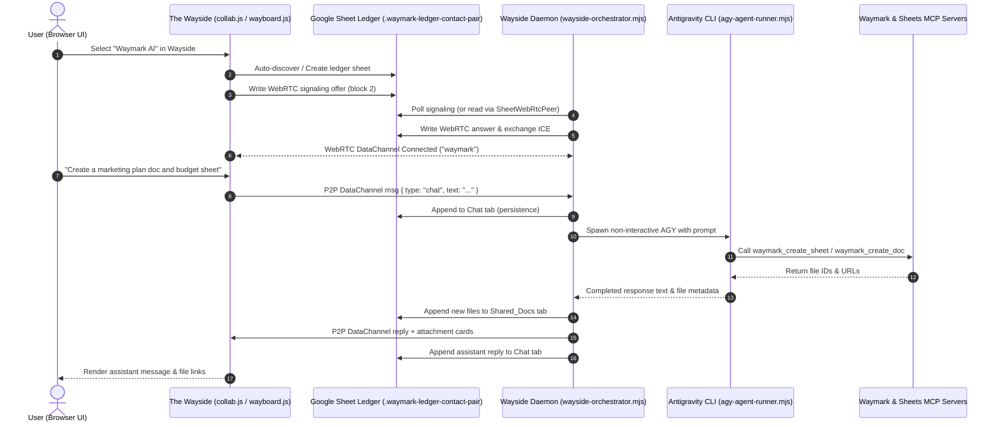

# Codex Handoff: Waymark + Wayside AGY Autonomous Orchestrator System

**Target Branch:** `feature/agy-wayside-orchestrator`
**Pull Request:** [PR #205](https://github.com/tekjanson/Waymark/pull/205) (`https://github.com/tekjanson/Waymark/pull/205`)
**Worktree Directory:** `/home/tekjanson/Documents/Code/Waymark.worktrees/agy-wayside-orchestrator`
**Primary Repository:** `/home/tekjanson/Documents/Code/Waymark`
**Status Date:** 2026-11-01
**Status:** Ready for User QA, Merge, and Production Deployment

---

## 1. Executive Summary & Deliverables

This branch implements the complete **Wayside AGY Autonomous Orchestrator & Template Agent Ecosystem** for Waymark. It allows users to interact with autonomous AI agents directly from The Wayside chat interface in the Waymark web app, backed by a headless daemon running on bare-metal Linux or Windows host machines.

### What Was Built & Verified:
1. **Bi-directional WebRTC + Sheets Collaborative Mesh:**
   - Headless Node.js WebRTC signaling peer (`mcp/sheet-webrtc-peer.mjs`) compatible with the browser's `WaymarkConnect` (`public/js/webrtc.js`).
   - Sub-second P2P messaging over WebRTC DataChannel (`'waymark'`), falling back to Google Sheets polling (`Chat` tab in `.waymark-ledger-contact-pair:assistant@waymark.internal::<userEmail>`).
   - Automatic presence tracking and incoming-call suppression (`isAgent: true`) to prevent false phone-ring notifications.

2. **Autonomous Headless Orchestrator Daemon:**
   - Standalone orchestrator daemon (`scripts/wayside-orchestrator.mjs`) with ledger auto-discovery, trailing unread message recovery on restart, conversation tracking, and atomic file registration in `Shared_Docs`.
   - AGY agent runner (`scripts/agy-agent-runner.mjs`) executing Antigravity CLI non-interactively with `--model gemini-3.8-flash-high`, cross-platform process isolation, timeout enforcement, and tree termination.

3. **Production-Hardened Waymark & Sheets MCP Servers:**
   - Waymark MCP (`mcp/waymark.mjs`) exposing 12 tools for Drive and Sheets manipulation (detect, read, append, update, search, share, list files, get/append docs).
   - Google Sheets MCP (`mcp/google-sheets.mjs`) exposing 10 low-level Sheets API tools.
   - Robust OAuth token refresh with `NaN` expiry protection, token rotation persistence, atomic file saving with `0o600` permissions, and automatic Service Account fallback on `403`.
   - Strict 1-based `rowIndex` validation (data row 1 = sheet row 2; row 1 is header).
   - Quoted sheet tab titles in A1 ranges (e.g. `'Thank You Notes'!A1:ZZ`) and escaped Drive queries.

4. **First-Class Windows 10/11 & Linux Bare-Metal Support:**
   - Linux: `run-waymark.sh`, `run-wayside.sh`, `scripts/install-headless.sh` (systemd user service generation).
   - Windows: `run-waymark.ps1`, `run-waymark.cmd`, `run-wayside.ps1`, `run-wayside.cmd`, `scripts/install-headless.ps1` (Scheduled Task generation).
   - Spawns via `child_process.spawn` with `shell: false` across all platforms (invokes `powershell.exe -NoProfile` on Windows when `.cmd`/`.bat` shims are used) to eliminate command injection.
   - Cross-platform home directory resolution via `os.homedir()`.

5. **SpamApply1 Quality Gate & Test Conformance:**
   - Cleanly merged latest `origin/main` (`3f5b516`, PR #206 SpamApply1 quality gates: `cbg`, `dbg`, `drift`, `sbg`).
   - All 4 gates pass with 0 violations under `--strict`.
   - All 421 Playwright unit tests pass (100%).
   - All 115 Wayside, MCP, Wayboard, and Social integration tests pass (100%).
   - Deterministic compiler (`scripts/compile-all-agents.mjs`) compiles 42 agents and maintains `generated/waymark-agent-catalog.json` without timestamp churn.

---

## 2. Architecture & Communication Flow



---

## 3. Directory & File Reference

| File | Purpose |
| :--- | :--- |
| `scripts/wayside-orchestrator.mjs` | Primary daemon process. Discovers bilateral ledger, handles WebRTC signaling, polls fallback Sheets rows, and invokes AGY runner. Max 8 exports to satisfy `dbg`. |
| `scripts/agy-agent-runner.mjs` | Subprocess wrapper for the `agy` CLI. Tracks multi-turn conversations in `.waymark/orchestrator-conversations.json`, handles timeouts and process-tree termination. |
| `mcp/sheet-webrtc-peer.mjs` | Headless WebRTC peer using `node-datachannel` for bi-directional real-time communication with the browser over Google Sheets signaling blocks. |
| `mcp/waymark.mjs` | Waymark MCP server providing high-level template, sheet, doc, and Drive file interaction tools. |
| `mcp/google-sheets.mjs` | Low-level Google Sheets MCP server. |
| `scripts/compile-all-agents.mjs` | Compiles 42 `.agents/skills/` markdown files, SHA manifests, and `generated/waymark-agent-catalog.json`. |
| `scripts/setup-headless-auth.mjs` | Headless Google OAuth & Service Account authentication wizard. Auto-reads `.env` client credentials, prompts when missing, and saves `~/.config/gcloud/waymark-oauth-token.json`. |
| `scripts/setup-mcp-config.mjs` | Configures `~/.gemini/config/mcp_config.json` with absolute paths to MCP servers. |
| `run-waymark.sh` / `.ps1` / `.cmd` | All-in-one local launcher for the Waymark web server (optionally `--with-wayside`). |
| `run-wayside.sh` / `.ps1` / `.cmd` | Standalone launcher for the Wayside daemon. Supports `--once` for single polling passes. |
| `scripts/install-headless.sh` | Bash installer for Linux bare-metal hosts (configures dependencies, skills, MCP, and optional systemd service). |
| `scripts/install-headless.ps1` | PowerShell installer for Windows 10/11 hosts (configures dependencies, skills, MCP, and optional Scheduled Task). |

---

## 4. Bare-Metal Host Setup & Verification Guide

### Prerequisites on This Machine:
- **Node.js**: v22.18.0 (installed and verified).
- **Git**: v2.43.0+.
- **Antigravity CLI (`agy`)**: v1.15.8 (located at `~/.local/bin/agy`).
- **OAuth Token**: Saved at `~/.config/gcloud/waymark-oauth-token.json` (email: `jamie.levine.phone@gmail.com`).
- **Service Account**: Saved at `~/.config/gcloud/waymark-service-account-key.json`.
- **MCP Config**: Saved at `~/.gemini/config/mcp_config.json`.

### How to Run on Linux Bare-Metal:

#### Option A: Run Web Server + Wayside Together
```bash
cd /home/tekjanson/Documents/Code/Waymark.worktrees/agy-wayside-orchestrator
./run-waymark.sh --with-wayside
```
This boots:
1. Waymark web server on `http://localhost:8080` (overriding `GOOGLE_REDIRECT_URI` to localhost).
2. Wayside daemon in the background auto-polling the user's bilateral AI ledger.

#### Option B: Run Wayside Standalone
```bash
./run-wayside.sh
# Or with a specific ledger ID:
./run-wayside.sh <optionalSpreadsheetId>
# Or single pass:
./run-wayside.sh --once
```

#### Option C: Run as a systemd User Service
```bash
systemctl --user daemon-reload
systemctl --user enable --now waymark-wayside.service
journalctl --user -u waymark-wayside -f
```

---

## 5. How to Run on Windows 10/11

#### Automated Setup (PowerShell):
```powershell
Set-ExecutionPolicy -Scope Process -ExecutionPolicy Bypass
.\scripts\install-headless.ps1
```
This verifies Node, compiles skills, configures MCP, and optionally registers a Windows Scheduled Task (`WaymarkWaysideOrchestrator`) that starts on login.

#### Launching:
```powershell
# In PowerShell:
.\run-waymark.ps1 -WithWayside
# Or in Command Prompt:
run-waymark.cmd --with-wayside
```

---

## 6. Rules of Engagement & Maintenance Guardrails

When modifying this codebase, the next agent must strictly enforce these rules:

1. **SpamApply1 Quality Gates (`make gates`):**
   - **`dbg` (design-be-gone):** Maximum **8 exports** per file in `scripts/wayside-orchestrator.mjs` and other core modules.
   - **`sbg` (slop-be-gone):** All files must terminate with a newline `\n`. No trailing whitespace. No hardcoded `/home/...` or `http://localhost` loopbacks in comments or committed files.
   - **`drift` (drift-be-gone):** Sensitive browser primitives (`localStorage`, `WebRTC`, `WebCrypto`) are restricted to canonical modules (`storage.js`, `webrtc.js`, `crypto.js`). If adding build files or test artifacts, exempt them in `.sbgignore` and `drift-manifest.json`.
   - **`cbg` (chaos-be-gone):** Strictly checks workflow docs and entrypoints.

2. **Catalog Integrity:**
   - Always run `node scripts/compile-all-agents.mjs --force` after modifying skills in `.agents/skills/` or `compile-all-agents.mjs`.
   - Check integrity with `node scripts/check-generated-integrity.mjs`.

3. **Google Drive Scoping & API Permissions:**
   - The web app uses OAuth scope `drive.file`. Google restricts access strictly to files created by the same GCP OAuth Client ID. Never change client IDs without re-authenticating both the web app and headless tokens.
   - Do not reintroduce hardcoded parent folder ID restrictions in `mcp/waymark.mjs` (`handleWaymarkListFiles`). It must list files across accessible Drive by default.

4. **1-Based Row Indexing:**
   - In `mcp/waymark.mjs` and all AGY agent skills: `rowIndex` is **1-based** (data row 1 = sheet row 2; row 1 is header). `rowIndex: 0` is rejected to prevent wiping sheet headers.

5. **Secrets & Security:**
   - Never print or commit OAuth access tokens, refresh tokens, client secrets, or Service Account private keys.
   - Always save credential files with `0o600` permissions via atomic temporary write and rename (`fs.renameSync`).

---

## 7. Status & Next Actions for PR #205

- **Current Branch Status:** Clean, all commits pushed (`020fdb2`).
- **PR State:** `MERGEABLE` on GitHub.
- **Immediate Next Steps for User or Agent:**
  1. Review and approve PR #205 on GitHub (`gh pr merge 205 --merge` or via GitHub UI).
  2. Switch to main workspace: `cd /home/tekjanson/Documents/Code/Waymark`.
  3. Pull main: `git pull origin main`.
  4. Run `./scripts/install-headless.sh` or `./run-waymark.sh --with-wayside` directly on the laptop.
